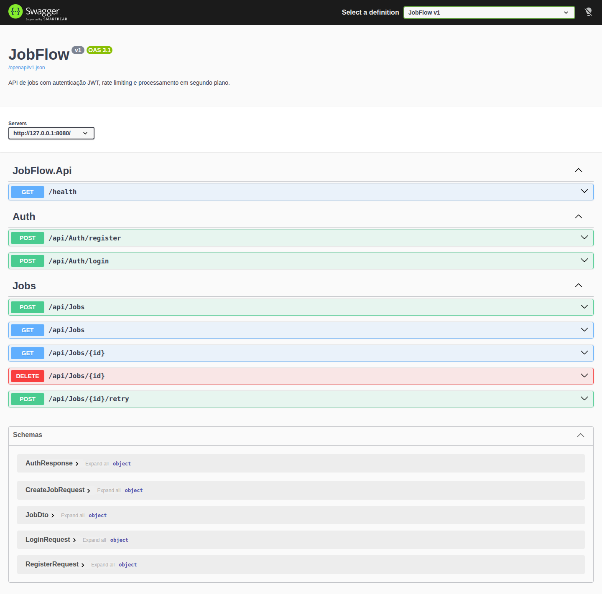

# JobFlow

[](https://github.com/JVCSampaio/jobflow/actions/workflows/ci.yml) [Portfólio](https://github.com/JVCSampaio)

**Backend de jobs** em **C# / .NET 10** (ASP.NET Core Web API): autenticação JWT, rate limiting, exception handling global, background worker com retry/backoff, EF Core + PostgreSQL e testes de integração, tudo dentro de **Docker** com **CI** no GitHub Actions.

O serviço mantém o estado dos jobs, executa tarefas em segundo plano e permite novas tentativas após falhas. A documentação apresenta a arquitetura, a API e as instruções de execução.

## Funcionalidades e implementação

| Capacidade | Implementação |
|---|---|
| **Autenticação JWT** | `AuthController` + `JwtBearer` (HMAC-SHA256) |
| **Rate limiting** | `RateLimitMiddleware` (janela fixa por IP, 60 req/min) |
| **Exception handling** | `ExceptionMiddleware` mapeia exceções para status HTTP |
| **Retry/backoff** | `JobProcessor` (máquina de estados pura, testável) |
| **Background worker** | `JobWorker` (`IHostedService`) |
| **EF Core + migrations** | `JobFlowDbContext` + `Migrations/` |
| **Testes de integração** | `WebApplicationFactory` + InMemory |
| **OpenAPI** | Swagger UI em `/swagger`, ligado em Development e com `ENABLE_SWAGGER=true` |

## Arquitetura

```
        ┌──────────────────────────────────────┐
        │  Client                              │
        └───────────────┬──────────────────────┘
                        │  HTTP + Bearer JWT
                        ▼
        ┌──────────────────────────────────────┐
        │  ASP.NET Core Web API                │
        │  ExceptionMiddleware → RateLimit     │
        │  → Auth → Controllers                │
        └───────────────┬──────────────────────┘
                        │
          ┌─────────────┴─────────────┐
          ▼                           ▼
   ┌─────────────┐            ┌─────────────────┐
   │  DbContext  │            │  JobWorker      │
   │  (EF Core)  │            │  (IHostedService)│
   └──────┬──────┘            └────────┬────────┘
          │                            │ claim + process
          ▼                            ▼
   ┌─────────────┐            ┌─────────────────┐
   │  PostgreSQL │            │  JobProcessor   │
   │  users, jobs│            │  retry/backoff  │
   └─────────────┘            └─────────────────┘
```

## Como rodar

### Docker (recomendado)

```bash
docker compose up --build
```

Sobe o Postgres, cria as tabelas (migrations no startup) e sobe a API em `http://localhost:8080`. A documentação interativa fica em `http://localhost:8080/swagger`.

### Manual (sem Docker)

```bash
# 1. banco (docker ou local)
docker run -d -p 5432:5432 -e POSTGRES_USER=jobflow \
  -e POSTGRES_PASSWORD=jobflow -e POSTGRES_DB=jobflow postgres:16-alpine

# 2. rodar a API
export JWT_SIGNING_KEY="***"
export DATABASE_URL="Host=localhost;Port=5432;Database=jobflow;Username=jobflow;Password=jobflow"
dotnet run --project src/JobFlow.Api
```

O perfil `http` escuta em `http://localhost:5284`. A documentação fica em `/swagger`.

## API (exemplos)

| Endpoint | Auth | O que retorna |
|---|---|---|
| `GET /health` | não | `{"status":"ok"}` |
| `POST /api/auth/register` | não | `201` + JWT token |
| `POST /api/auth/login` | não | `200` + JWT token |
| `POST /api/jobs` | Bearer | `201` + job criado |
| `GET /api/jobs` | Bearer | lista de jobs |
| `GET /api/jobs/{id}` | Bearer | job |
| `POST /api/jobs/{id}/retry` | Bearer | job reenfileirado |
| `DELETE /api/jobs/{id}` | Bearer | `204` |

Exemplo de fluxo:

```bash
TOKEN=$(curl -s -X POST http://localhost:8080/api/auth/register \
  -H 'Content-Type: application/json' \
  -d '{"username":"demo","email":"demo@example.com","password":"***"}' | jq -r .token)

curl -s -X POST http://localhost:8080/api/jobs \
  -H "Authorization: Bearer $TOKEN" -H 'Content-Type: application/json' \
  -d '{"name":"process-order","payload":"order-42"}'
```

### Documentação interativa

Com a API em execução, o Swagger UI lista os endpoints, os modelos e as respostas em `/swagger`. Ele fica ligado no ambiente Development e no `docker-compose.yml` (`ENABLE_SWAGGER=true`). Em qualquer outro ambiente, `/swagger` e `/openapi/v1.json` respondem 404, para um deploy de produção não publicar o esquema da API.



## Testes e CI

```bash
dotnet test JobFlow.slnx        # 23 testes (unit + integração)
```

- **Unit:** `JobProcessorTests` (retry/backoff), `UserServiceTests` (BCrypt + JWT round-trip).
- **Integração:** `ApiIntegrationTests` sobe a API completa via `WebApplicationFactory` com banco InMemory: register, login, CRUD de jobs, retry e rate limit.

O workflow `.github/workflows/ci.yml` roda build + testes em cada push.

## Decisões técnicas (o porquê)

- **`JobProcessor` puro (sem DB).** A máquina de estados (retry/backoff) é separada do worker, então é testável sem banco ou network.
- **`WebApplicationFactory` + InMemory nos testes.** Roda a API inteira (middleware, JWT, controllers) contra um banco InMemory, integração sem Postgres.
- **Rate limiter singleton (sem `RequestDelegate` ctor).** Invocado via delegate que resolve o singleton do DI, padrão para middlewares que não seguem o ctor tradicional.
- **Exception middleware global.** Mapeia `DbUpdateException`→409, `KeyNotFoundException`→404, `InvalidOperationException`→409; loga o resto com correlation id.
- **Migrations no startup (gateable).** `RUN_MIGRATIONS_ON_STARTUP` permite desligar em testes; em produção sobe o schema automaticamente.

## Estrutura

```
jobflow/
├── docs/
│   └── swagger.png           # captura da documentação em /swagger
├── src/JobFlow.Api/
│   ├── Controllers/          # AuthController, JobsController
│   ├── Middleware/           # ExceptionMiddleware, RateLimitMiddleware
│   ├── Services/             # UserService (BCrypt + JWT)
│   ├── Workers/              # JobProcessor (state machine), JobWorker (IHostedService)
│   ├── Data/                 # JobFlowDbContext, Entities, DesignTimeDbContextFactory
│   ├── DTOs/                 # Dtos
│   ├── Migrations/           # InitialCreate
│   └── Program.cs            # JobFlowApi (entry point + DI + pipeline)
├── tests/JobFlow.Tests/
│   ├── JobProcessorTests.cs
│   ├── UserServiceTests.cs
│   ├── ApiIntegrationTests.cs
│   └── TestHost.cs
├── .github/workflows/ci.yml
├── Dockerfile
├── docker-compose.yml
├── JobFlow.slnx
├── LICENSE
└── README.md
```

## Limitações e roadmap

**Limitações:**
- Rate limiter em memória (single-instance); em produção com multi-instância, usar Redis.
- Worker processa em loop simples; para alto volume, usar fila (RabbitMQ/Azure Service Bus).
- Sem paginação na lista de jobs (apenas `take`, sem offset).

**Roadmap (proposital):**
- **Fila externa** (RabbitMQ) para desacoplar API e worker.
- **Distributed tracing** (OpenTelemetry) para observabilidade.

## Licença

MIT. Veja [LICENSE](LICENSE).
